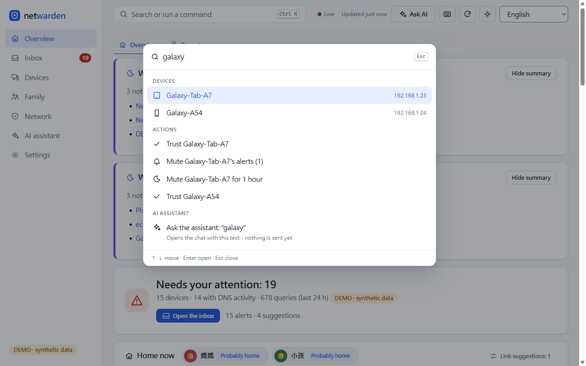

# netwarden

[](https://github.com/liming-ting/netwarden/actions/workflows/ci.yml)
[](https://github.com/liming-ting/netwarden/actions/workflows/docker.yml)
License: [AGPL-3.0-or-later](LICENSE)

[繁體中文](README.zh-TW.md)

**See every device on your home network and what it talks to, explained in plain language -
on your own hardware, with nothing leaving your home unless you choose to send it**
([what can leave, and when](#privacy-what-can-leave-your-network-and-when)).

netwarden finds the devices on your LAN, reads who they talk to from the AdGuard Home or
Pi-hole you already run, and tells you what is new, odd or risky in words a family can act
on. It is read-only: it never changes your router or your DNS filter.

**[Live demo](https://liming-ting.github.io/netwarden/)** - the real dashboard on a made-up
home, in your browser: read-only, nothing to install, nothing is sent anywhere.


> Status: **early preview (0.1.0).** It works for its author's home; expect rough edges.

## Install

Pick one. Full guide, with Docker Desktop, upgrades, backups and uninstalling:
[docs/install.md](docs/install.md).

**Docker** (a Linux host, Raspberry Pi or NAS on your LAN; host networking so discovery can
see the network):

```bash
git clone https://github.com/liming-ting/netwarden netwarden && cd netwarden
cp deploy/netwarden.env.example deploy/netwarden.env     # your AdGuard Home / Pi-hole address
docker compose -f deploy/compose.yaml up -d
docker compose -f deploy/compose.yaml logs netwarden     # shows a one-time admin code
```

Open `http://<that machine>:8787` and enter the code; the first-run page checks the
connection to your DNS filter. `deploy/compose.adguard.yaml` also starts AdGuard Home.

**Home Assistant add-on** (HA OS / Supervised): Settings > Add-ons > Add-on Store >
Repositories, add `https://github.com/liming-ting/netwarden`, install *netwarden*, choose
the DNS source on its Configuration tab, open it from the sidebar. See
[docs/home_assistant.md](docs/home_assistant.md).

**Linux / Raspberry Pi without Docker** (a systemd service, from a checkout):

```bash
sh scripts/install_linux.sh --dry-run      # shows every action, changes nothing
sudo sh scripts/install_linux.sh           # then edit /etc/netwarden/netwarden.env
```

**Just look first:** the [live demo](https://liming-ting.github.io/netwarden/), or locally
from a checkout (Python 3.11+, standard library only, no pip packages):
`python3 -m netwarden run --demo --offline-ai`, then http://127.0.0.1:8787. On Windows,
`scripts\start_demo_windows.cmd` starts the demo inside WSL (port 8788).

## What you need

- **AdGuard Home or Pi-hole v6** for "what does each device talk to". netwarden has no DNS
  resolver of its own: it reads their query log over their HTTP API, read-only
  ([docs/pihole.md](docs/pihole.md)). Your devices must use the filter **directly** (or
  every query looks like it came from the router).
- **Without them** you still get device discovery and identification, router / internet
  health and an outage log, the opt-in open-port check, UPnP port mappings, people and
  rooms, the inbox, the report and notifications - just no per-device DNS.
- Optional: **ntopng** for bytes per device ([docs/bandwidth.md](docs/bandwidth.md)); an
  **AI model** (Anthropic, or a local Ollama / LM Studio server) for free-form questions -
  without one the assistant answers from rules on your own data
  ([docs/private_ai.md](docs/private_ai.md)).

## What it does

**See**
- Finds devices (ping / ARP, mDNS, SSDP/UPnP, NetBIOS, DHCP names, reverse DNS), guesses
  each one's type and shows why; you can rename and correct anything.
- People and rooms for devices; a network map.

**Understand**
- Per-device DNS: which services and trackers each device uses, a privacy grade (A-F),
  risky clouds, DNS blind spots (DNS-over-HTTPS).
- Alerts for new devices, unusual hours, open ports, bandwidth spikes - each with
  "Why this alert?".
- Network health: is it the router, the internet provider or DNS? An outage log.
- A 0-100 home score with suggestions: steps and copyable rules you apply yourself.
- Family: screen-time *estimates*, notify-only bedtime rules, a printable weekly report.
- An assistant you can ask ("why is the camera talking to that domain?").

**Stay informed**
- One inbox for alerts and suggestions: mute, snooze, trust, undo; quiet hours.
- **Opt-in push notifications**: ntfy, Gotify, Home Assistant, a signed JSON webhook, or
  Discord, Slack, Telegram, LINE and Matrix - per channel a privacy level, quiet hours, a
  rate limit and an exact preview of the request ([docs/notifications.md](docs/notifications.md)).
- A **shareable home report** (7 or 30 days) as one self-contained HTML file or Markdown;
  the default level hides MACs, IPs, domains and family names ([docs/report.md](docs/report.md)).

**Use it your way**
- 12 languages (default Traditional Chinese), light and dark, phone and desktop.
- Keyboard first: **Ctrl+K** (**Cmd+K** on a Mac) opens a command palette for devices,
  people, pages, settings and actions; `?` lists every shortcut.
- Phone access on your LAN after pairing ([docs/lan.md](docs/lan.md)).

| | |
|---|---|
|  |  |
|  |  |
|  | |

All screenshots use the built-in synthetic demo home (`python3 -m netwarden demo`).

## Privacy: what can leave your network, and when

**Nothing leaves your network unless you configure an AI provider or a notification
channel, or turn on one of the opt-in downloads / the probe in the table below - and you
can see exactly what is sent.** No telemetry, no account, no cloud service of its own.
(AdGuard Home, Pi-hole and ntopng are queried at the addresses you give, normally on your
LAN.)

| What | When | Where to |
|---|---|---|
| A summarized snapshot of your network + your question | **only when you click** Ask / Generate insight | the AI you configured: Anthropic (cloud), your OpenAI-compatible server (local / LAN / cloud), or nowhere in offline mode |
| A short notification text (privacy level per channel) | only for channels you added and turned on, when an alert / digest you chose happens, or when you click Send test | the service you chose: your own ntfy / Gotify / Home Assistant / webhook (normally your LAN), or Discord, Slack, Telegram, LINE, Matrix (the text passes through that company) |
| Queries to AdGuard Home / Pi-hole / ntopng | every 30-60 s while `run` is running | the addresses you configured (normally your LAN) |
| Vendor database (OUI) and threat-feed downloads | only when you run `python3 -m netwarden scan --update-vendors` / `python3 -m netwarden.threatintel --update "URL"` | wireshark.org / the list you choose, e.g. abuse.ch URLhaus (needs a free abuse.ch Auth-Key; download only, nothing about you is sent; see [THIRD_PARTY_NOTICES.md](THIRD_PARTY_NOTICES.md)) |
| Optional internet probe (a TCP connect, no data) | only if you set `health.internet_probe` (empty = off, the default) | the host:port you enter, e.g. `1.1.1.1:443` |

- Background loops and page loads never call the AI.
- **Redaction is on by default for cloud AI**: device names, hostnames, owners, rooms,
  MACs and private IPs are replaced by tokens (`[D3]`, `[P1]`, `[M2]`, `[IP4]`) and mapped
  back locally. Domains, vendors, counts and times are not hidden - that is what the AI
  reasons about. **Preview what will be sent** shows the exact text first.
- Notifications are written by fixed templates, never by an AI. A new channel starts
  paused; the default level never sends MAC/IP addresses or raw domains; the editor shows
  the exact request before you turn it on.
- **Read-only toward your network:** no changes to your router, firewall, AdGuard Home or
  Pi-hole; no ARP spoofing, no MITM, no packet capture. Your actions (rename, trust, mute)
  only write netwarden's own SQLite database. It blocks nothing by itself and does not
  replace a firewall or antivirus.
- On a desktop, `run` listens on 127.0.0.1 only. The Docker image, the compose files and
  the Linux service turn LAN mode on; LAN access always requires pairing.

## Limitations (honest)

- **Under WSL2 or Docker Desktop, discovery sees few devices** (the VM's network hides most
  of the LAN). A Linux host, Raspberry Pi or the HA add-on on the same LAN works best.
- Per-device DNS needs devices to use AdGuard Home / Pi-hole directly; devices using
  DNS-over-HTTPS bypass it (netwarden flags those blind spots).
- Screen time, presence and "unusual" are **estimates** from DNS timing, not measurements.
  Device types are educated guesses you can correct.
- Pi-hole v6 and ntopng support were built against their official API docs and tested with
  fake servers; AdGuard Home was tested on a real install. Bandwidth needs ntopng where the
  traffic passes.
- The container images and the Home Assistant add-on are built and smoke-tested in CI;
  real-world testing on NAS boxes and Home Assistant hardware is still thin.
- Translations other than English and Traditional Chinese are machine-assisted; native
  speakers' fixes are very welcome.
- One home per installation, no user accounts; no HTTPS of its own (use LAN mode with pairing, or your own reverse
  proxy).

## How it was built

netwarden was built with heavy AI assistance (Claude Code) under human direction: the
author decided what to build and the hard rules (read-only, standard library only, no
telemetry) and reviewed the results; much of the code, tests and translations were written
by the AI. It is covered by a large automated test suite (unittest, fake servers only, no
network) that runs in CI on every push. Please read the code with that in mind and report
what you find.

## Roadmap

- Feedback from the first users; fixing what the preview gets wrong.
- HTTPS for LAN mode; a breakdown of block reasons; more device-type rules and service maps.

## Contributing

Bug reports, translations and small focused pull requests are welcome - see
[CONTRIBUTING.md](CONTRIBUTING.md). Security issues: please report privately, see
[SECURITY.md](SECURITY.md). Everyone is expected to follow the
[Code of Conduct](CODE_OF_CONDUCT.md). Changes: [CHANGELOG.md](CHANGELOG.md).
Third-party code and data: [THIRD_PARTY_NOTICES.md](THIRD_PARTY_NOTICES.md).

## License

Copyright (C) 2026 liming-ting and contributors.

netwarden is free software under the **GNU AGPL v3 or later** (SPDX `AGPL-3.0-or-later`,
full text in [LICENSE](LICENSE)). In plain words:

- You may use it, study it, change it and self-host it, at home or anywhere else.
- If you give a copy to other people (modified or not), you must also give them the
  source of that version under the same license.
- If you change it and let other people use your modified version over a network (for
  example a dashboard others can open), you must offer those users the source of your
  version under the same license. The Settings page links to the source for this reason.
- It comes with no warranty.

This summary is not legal advice; the LICENSE text decides. Third-party parts and their
licenses are listed in [THIRD_PARTY_NOTICES.md](THIRD_PARTY_NOTICES.md).
