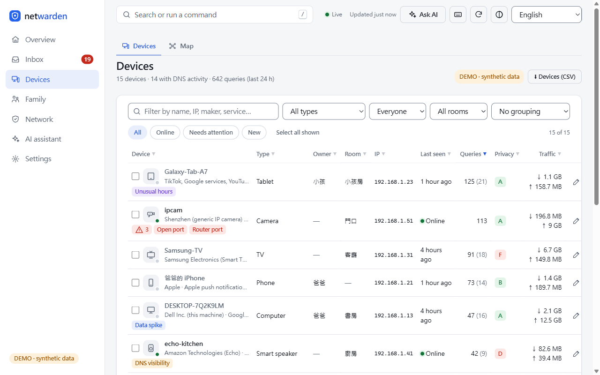
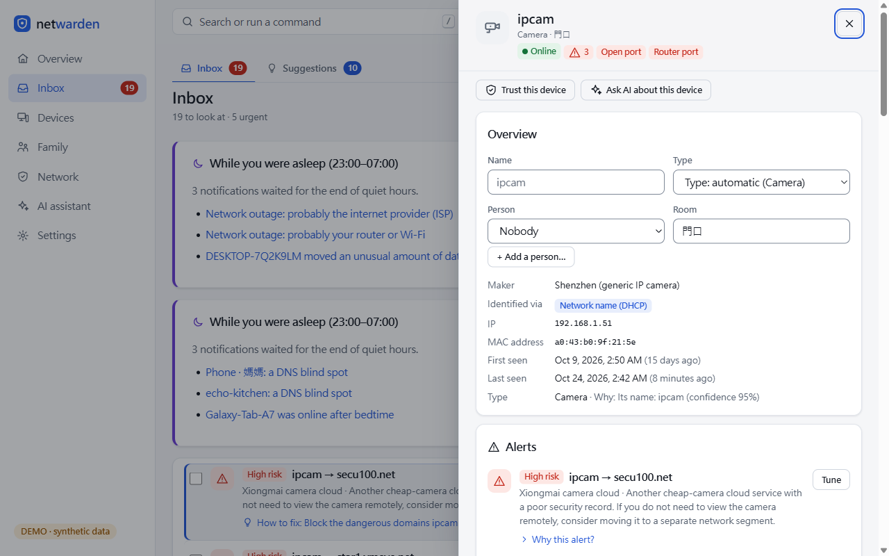
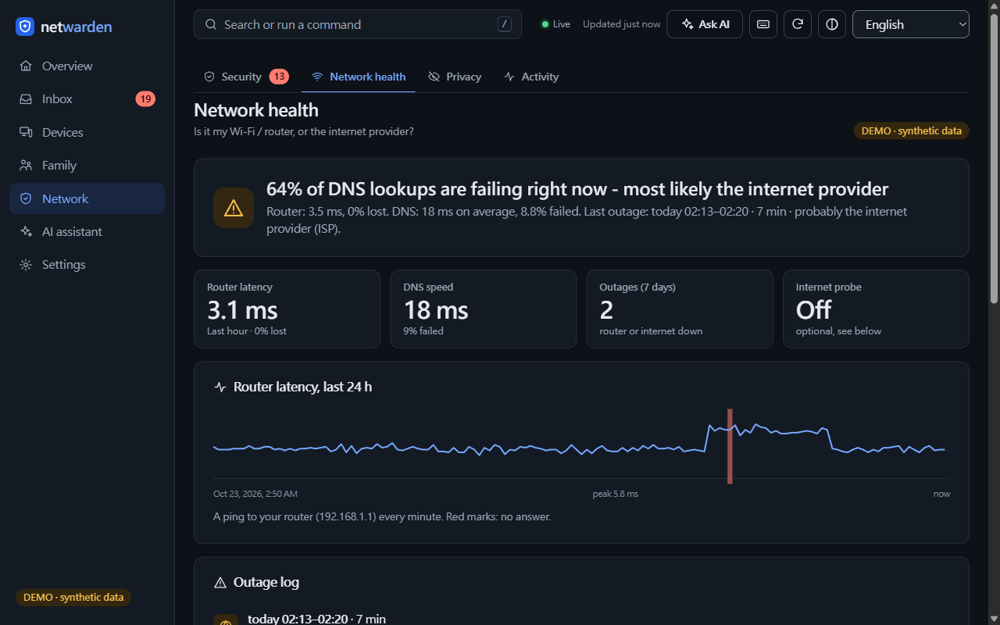
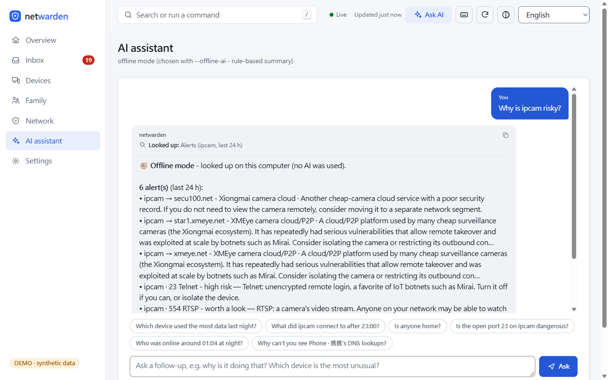
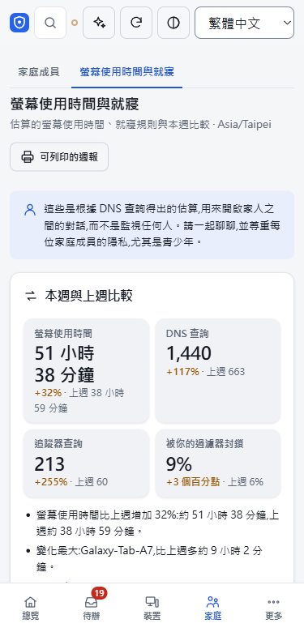

# netwarden

[](https://github.com/liming-ting/netwarden/actions/workflows/ci.yml)
[](https://github.com/liming-ting/netwarden/actions/workflows/docker.yml)
License: [AGPL-3.0-or-later](LICENSE)

[繁體中文](README.zh-TW.md)

**Your home network, explained in plain language - privately.** netwarden finds the devices
on your LAN, reads who they talk to from your own AdGuard Home or Pi-hole, and tells you what
is new, odd or risky in words a family can act on. The AI is optional: use a cloud model,
a local OpenAI-compatible server such as Ollama, or no model at all (deterministic offline
explanations).

> Status: **0.1.0, first public preview.** It works for its author's use; expect rough edges.



## Who it is for

- Homelab users who already run (or are willing to run) AdGuard Home or Pi-hole and want
  more than a query log: "which device is this, is it normal, should I care?"
- Families who want a calm overview - new devices, a camera talking to a risky cloud,
  a tablet online after bedtime - without a subscription or a cloud account.

## What it does

- **See** - discovers devices (ping/ARP sweep, mDNS, SSDP/UPnP, NetBIOS, DHCP names,
  reverse DNS), guesses each device's type and explains why.
- **Watch** - per-device DNS activity from AdGuard Home or Pi-hole v6; optional bytes
  per device from ntopng; router/ISP/DNS health and an outage log.
- **Explain** - alerts with "Why this alert?", privacy grades (tracker share), risky
  clouds, open ports (opt-in check), DNS blind spots (DoH), screen-time estimates and
  notify-only bedtime rules, a 0-100 home score with suggestions, and an assistant you can
  ask questions.
- Dashboard in 12 languages (default Traditional Chinese), light and dark, phone and desktop,
  keyboard accessible; optional phone access on your LAN with pairing.

| | |
|---|---|
|  |  |
|  |  |

All screenshots use the built-in synthetic demo home (`python3 -m netwarden demo`).

## What it does not do

- **Read-only.** It never changes your router, firewall, AdGuard Home or Pi-hole. Fixes are
  suggestions: steps and copyable rules you apply yourself. Your actions in netwarden
  (rename, trust, mute, snooze) only write netwarden's own SQLite database.
- **No telemetry**, no account, no cloud service of its own.
- **No ARP spoofing, no MITM, no packet capture.** It does not rebuild DNS logging or
  traffic sniffing; it reads AdGuard Home / Pi-hole / ntopng.
- It does not block anything by itself and does not replace a firewall or antivirus.

## Quick start

Full guide: [docs/install.md](docs/install.md). Python 3.11+, standard library only (no
pip dependencies). After the first start of a headless install, the log shows a one-time
admin code to claim the dashboard from your browser.

**Docker compose** (Linux host, host networking so discovery sees the LAN):

```bash
git clone https://github.com/liming-ting/netwarden netwarden && cd netwarden
docker compose -f deploy/compose.yaml up -d
docker compose -f deploy/compose.yaml logs netwarden     # the one-time admin code
```

`deploy/compose.adguard.yaml` adds AdGuard Home next to it; `deploy/compose.bridge.yaml` is
for Docker Desktop (fewer devices visible).

**Home Assistant add-on** (HA OS / Supervised): add `https://github.com/liming-ting/netwarden` as an
add-on repository, install *netwarden*, open it from the sidebar.
See [docs/home_assistant.md](docs/home_assistant.md).

**Linux / Raspberry Pi** (systemd service):

```bash
sh scripts/install_linux.sh --dry-run      # shows every action, changes nothing
sudo sh scripts/install_linux.sh
```

**Windows (WSL2)** or any desktop, from a checkout:

```bash
python3 -m netwarden run --demo --offline-ai   # try it: demo home, no AI, http://127.0.0.1:8787
python3 -m netwarden run                       # your network
```

On Windows, `scripts\start_windows.cmd` / `scripts\start_demo_windows.cmd` start it inside
WSL. Under WSL, discovery sees only a few devices (see Limitations).

## AdGuard Home and Pi-hole

netwarden has no resolver of its own. Point your devices (or your router's DHCP DNS
setting) at AdGuard Home or Pi-hole as usual; netwarden reads their per-client query log
over their HTTP API (`ADGUARD_URL` / `ADGUARD_USER` / `ADGUARD_PASS`, or `PIHOLE_URL` /
`PIHOLE_PASSWORD`) and maps client IPs to devices. Without a DNS source you still get
discovery and identification. Details: [docs/pihole.md](docs/pihole.md),
[docs/install.md](docs/install.md). Optional bytes per device:
[docs/bandwidth.md](docs/bandwidth.md).

## AI and privacy

Exactly what can leave the machine, and when:

| What | When | Where to |
|---|---|---|
| A summarized snapshot of your network + your question | **only when you click** Ask / Generate insight | the AI you configured: Anthropic (cloud), your OpenAI-compatible server (local / LAN / cloud), or nowhere in offline mode |
| Queries to AdGuard Home / Pi-hole / ntopng | every 30-60 s while `run` is running | the addresses you configured (normally your LAN) |
| Vendor database (OUI) and threat-feed downloads | only when you run `python3 -m netwarden scan --update-vendors` / `python3 -m netwarden.threatintel --update "URL"` | wireshark.org / the list you choose, e.g. abuse.ch URLhaus (needs a free abuse.ch Auth-Key; download only, nothing about you is sent; see [THIRD_PARTY_NOTICES.md](THIRD_PARTY_NOTICES.md)) |
| Optional internet probe (a TCP connect, no data) | only if you set `health.internet_probe` (empty = off, the default) | the host:port you enter, e.g. `1.1.1.1:443` |

- Background loops never call the AI; page loads never call the AI.
- **Redaction is on by default for cloud destinations**: device names, hostnames, owners,
  rooms, MACs and private IPs are replaced by tokens (`[D3]`, `[P1]`, `[M2]`, `[IP4]`) and
  mapped back locally. Domains, vendors, counts and times are not hidden - that is what the
  AI reasons about. **Preview what will be sent** shows the exact text first.
- Offline mode (`--offline-ai`, or no AI configured) answers from rules and lookups on your
  own data; nothing is sent anywhere.
- On a desktop, `run` listens on 127.0.0.1 only; LAN/phone access is off by default. The
  Docker image, the compose files and the Linux service turn LAN mode on. LAN access
  always requires pairing ([docs/lan.md](docs/lan.md)).

More: [docs/private_ai.md](docs/private_ai.md).

## Limitations (honest)

- **Under WSL2 or Docker Desktop, discovery sees few devices** (the VM's network hides most
  of the LAN). A Linux host, Raspberry Pi or the HA add-on on the same LAN works best.
- Per-device DNS needs devices to use AdGuard Home / Pi-hole **directly**; if everything is
  forwarded by the router, all queries look like the router. Devices using DNS-over-HTTPS
  bypass it (netwarden flags those blind spots).
- Screen time, presence and "unusual" are **estimates** from DNS timing, not measurements.
- Device types are educated guesses; you can correct them.
- Bandwidth needs ntopng positioned where traffic passes.
- Translations other than English and Traditional Chinese are machine-assisted; native
  speakers' fixes are very welcome.
- The Docker images and the Home Assistant add-on will be built and smoke-tested by CI on
  the first push; they have not yet been run on real Home Assistant hardware.
- Single home, single user model; no HTTPS of its own (use LAN mode with pairing, or put
  it behind your own reverse proxy).

## Roadmap

- Feedback from the first users; fixing what the preview gets wrong.
- HTTPS for LAN mode; a breakdown of block reasons; more device-type rules and service maps.
- Better coverage of hosts that WSL/Docker Desktop cannot see.

## How it was built

netwarden was built with heavy AI assistance (Claude Code) under human direction: the
author decided what to build and reviewed the results; much of the code, tests and
translations were written by the AI. It is covered by a large automated test suite
(1000+ unittest cases, fake servers only, no network) that runs in CI. Please read the code
with that in mind and report what you find.

## Contributing

Bug reports, translations and small focused pull requests are welcome - see
[CONTRIBUTING.md](CONTRIBUTING.md). Security issues: please report privately, see
[SECURITY.md](SECURITY.md). Everyone is expected to follow the
[Code of Conduct](CODE_OF_CONDUCT.md). Changes: [CHANGELOG.md](CHANGELOG.md).
Third-party code and data: [THIRD_PARTY_NOTICES.md](THIRD_PARTY_NOTICES.md).

## License

Copyright (C) 2026 liming-ting and contributors.

netwarden is free software under the **GNU AGPL v3 or later** (SPDX `AGPL-3.0-or-later`,
full text in [LICENSE](LICENSE)). In plain words:

- You may use it, study it, change it and self-host it, at home or anywhere else.
- If you give a copy to other people (modified or not), you must also give them the
  source of that version under the same license.
- If you change it and let other people use your modified version over a network (for
  example a dashboard others can open), you must offer those users the source of your
  version under the same license. The Settings page links to the source for this reason.
- It comes with no warranty.

This summary is not legal advice; the LICENSE text decides. Third-party parts and their
licenses are listed in [THIRD_PARTY_NOTICES.md](THIRD_PARTY_NOTICES.md).
